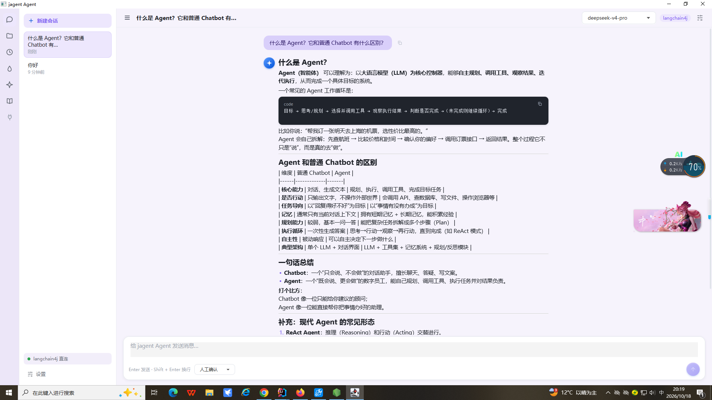

# jagent  桌面客户端
jagent 是一款功能全面的桌面智能体客户端，集成 CodeBuddy 桥接与 langchain4j 双模型后端，支持工具调用与权限审批，内置多知识库 RAG 检索（暂不完善）、Claude 风格技能加载、工作区文件浏览与代码编辑、cron 定时任务及项目指令注入，所有数据以 JSON 形式本地存储、无需外部数据库，开箱即用、轻量便携；对 Java 开发者而言它更是一份难得的"福音"——基于 langchain4j 直连 OpenAI 兼容接口，让熟悉 Java 生态的工程师无需切换技术栈，就能用最趁手的语言构建智能体应用，双模型后端、工具调用、RAG 知识库、技能加载等能力开箱即用，配合纯 JSON 本地存储、零外部数据库的轻量设计，大幅降低了 AI 应用的开发与部署门槛，让 Java 开发者也能快速拥抱大模型时代。
- **双模型后端**：CodeBuddy 桥接与 模型直连（OpenAI 兼容）
- **工具调用**：Read / Write / Bash / Glob / Grep，支持工具权限审批
- **知识库（RAG）**：多知识库管理、文档分块 + 向量化入库、检索问答
- **技能（Skills）**：发现 / 加载 / 编辑 Claude·CodeBuddy 风格 `SKILL.md`
- **工作区**：文件树浏览、代码编辑器、PDF / Excel 预览
- **定时任务**：cron 调度，绑定专属会话自动发送
- **项目指令（jagent.md）**：每次对话自动注入系统提示词（类似 CLAUDE.md）
- **零外部数据库**：会话 / 设置 / 知识库 / 技能 / 定时任务均以 JSON 存于 `data/`



## 架构

```
┌──────────────────────────────────────────────────────────────────────┐
│                        jagent 客户端（client/）                        │
│                                                                      │
│  UI 层（ui/）   ChatController（组合根）  ServiceAssembler（共享组装）    │
│      │                    │                        │                │
│      └────────────┬───────┴────────────────────────┘                │
│                   ▼                                                  │
│  Service 层（纯 Java，无 jagent.*）                                    │
│   ChatService · SessionService · ScheduleService · ConnectivityService│
│   KnowledgeService · SkillService · WorkspaceService · JagentService  │
│   SettingsService · Store（JSON 持久化）                               │
│      │                          │                                    │
│      │  ChatBackend             │  Harness 框架（生命周期统一管理）      │
│      ├─ CodeBuddyBackend        │                                    │
│      └─ Langchain4jBackend      │                                    │
└──────────────┬──────────────────┴────────────────────────────────────┘
               │ HTTP + SSE
               ▼
┌──────────────────────────────┐      ┌─────────────────────────────┐
│   Bridge 桥接服务（server/）   │ ───▶ │  CodeBuddy CLI（SDK 子进程）  │
│   Express + agent-sdk        │      └─────────────────────────────┘
└──────────────────────────────┘
```

## 目录结构

```
jagent/
├─ pom.xml                 父 POM（多模块：client / server / scripts）
├─ server/                 Node.js 桥接服务
│  ├─ index.js             Express + SSE（包装 @tencent-ai/agent-sdk）
│  ├─ package.json
│  ├─ start-clean.cjs      剥离沙箱环境变量后启动
│  └─ .env                 环境配置（自动生成）
├─ client/                 jagent 客户端（Maven 模块）
│  ├─ pom.xml              依赖 + 平台 profile（win/mac/linux/aarch64）
│  └─ src/main/java/com/jagent/
│     ├─ Main.java            启动器（classpath 模式）
│     ├─ App.java             jagent Application（--screenshot 自检）
│     ├─ ChatController.java  协调层（组装 UI 与 service）
│     ├─ ServiceAssembler.java  共享组装根（GUI / headless 复用）
│     ├─ HeadlessMain.java    无 UI 运行入口
│     ├─ chat/              model / service（ChatBackend、ChatService、
│     │                     CodeBuddyBackend、Langchain4jBackend、
│     │                     SessionService）/ tool（Read/Write/Bash/Glob/Grep）
│     ├─ connectivity/      ConnectivityService（服务自启动/登录/模型）
│     ├─ knowledge/         KnowledgeService / KnowledgeStore / LocalKnowledgeStore
│     ├─ schedule/          CronExpression + ScheduleService / ScheduleRunner
│     ├─ settings/          AppSettings / ProviderPreset / SettingsService
│     ├─ skill/             SkillService（SKILL.md 管理）
│     ├─ workspace/         WorkspaceService（文件浏览/读取）
│     ├─ jagent/            JagentService（jagent.md 指令注入）
│     ├─ harness/           Harness / HarnessRegistry / HarnessPipeline
│     ├─ common/            exception / util
│     ├─ store/             Store（JSON 持久化）
│     ├─ example/           AgentExample（headless 示例）
│     └─ ui/                视图层（Sidebar/ChatArea/Composer/FileTree/
│                           FileViewer/Knowledge/Skill/ActivityBar/Theme…）
├─ scripts/                 一键启动脚本
│  ├─ start-all.bat / start-server.bat / start-client.bat
│  ├─ download-libs.js      下载 jagent / Gson / langchain4j 等依赖
│  └─ install-deps.js       安装 npm 依赖
└─ data/                    运行时数据（JSON，自动生成）
```

## 快速开始

## 模型来源（Provider）
在 **设置 → API Key** 中直接填写 API Key，跳过浏览器登录（写入 `server/.env`） （只要有模型公司API KEY就可以录入使用）。


| 来源          | 说明 |
|-------------| --- |
| `大模型直接鏈接`   | 直连 OpenAI 兼容接口（默认），无需桥接服务，支持工具调用与知识库问答（RAG） |
| `CodeBuddy` | 经 Node 桥接服务调用 CodeBuddy CLI，支持工具权限审批与会话上下文恢复 |

`大模型直接鏈接` 模式下内置了若干服务商预设（持久化于 `data/providers.json`）：

| 服务商 | Base URL | 模型示例 |
| --- | --- | --- |
| DeepSeek | `https://api.deepseek.com/v1` | deepseek-flash / deepseek-v4-pro |
| 通义千问 | `https://dashscope.aliyuncs.com/compatible-mode/v1` | qwen3.8-max / qwen3.7-plus |
| 智谱 GLM | `https://open.bigmodel.cn/api/paas/v4` | GLM-5.3 / GLM-5.2 |
| Kimi | `https://api.moonshot.cn/v1` | kimi-k2.7-code / kimi-k3 |
| 硅基流动 | `https://api.siliconflow.cn/v1` | deepseek-ai/DeepSeek-V4-Flash 等 |

### 一键启动（Windows）

CodeBuddy代理

双击 `scripts\start-all.bat`，自动完成：

1. 检测/安装 Node.js 依赖（首次 `npm install`）
2. 检测/下载 jagent 与第三方 jar（首次从 Maven Central 下载）
3. 编译 Java 源码（源码更新时）
4. 启动桥接服务（窗口 1，端口 3210）
5. 启动 jagent 客户端（窗口 2）

也可分开启动：

```bat
:: 终端 1
scripts\start-server.bat

:: 终端 2
scripts\start-client.bat
```

### 仅启动服务

```bash
cd server && npm install && npm run dev   # http://localhost:3210
```

### Maven 构建与运行（跨平台，推荐）

```bash
cd client
mvn clean package                             # 编译 + 打包（Windows/macOS/Linux 通用）
mvn jagent:run                                # 启动客户端（自动拉起桥接服务）
mvn jagent:run -Djagent.args="--screenshot"   # 截图自检（写入 data/screenshot.png）
```

> `mvn jagent:run` 以 `client/` 为工作目录运行，数据写入 `client/data/`；
> 而 `.bat` / `javac` 流程以仓库根目录为工作目录，数据在根目录 `data/`。两者数据目录不同，切换启动方式时请留意会话是否「消失」。

## 登录

首次启动后，侧边栏状态条显示 **「未登录 · 点击登录」**。点击状态条弹出登录对话框：

1. 点击「开始登录」获取登录 URL
2. 自动打开浏览器完成 CodeBuddy 授权
3. 登录成功后回到客户端点击「我已完成登录」
4. 状态变为「已登录」，即可正常对话与工具调用

也可以在 **设置 → API Key** 中直接填写 API Key，跳过浏览器登录（写入 `server/.env`）。


## 功能

### 工具调用与权限

内置工具（`ToolKit`）：

| 工具 | 说明 | 需授权 |
| --- | --- | --- |
| `Read` | 读取文件 | 否 |
| `Write` | 写入文件 | 是 |
| `Bash` | 执行 shell 命令 | 是 |
| `Glob` | 按模式查找文件 | 否 |
| `Grep` | 内容检索 | 否 |

权限模式（**设置 → 工具权限模式**）：

| 模式 | 行为 |
| --- | --- |
| `default` | 每个工具调用弹出确认对话框（推荐） |
| `acceptEdits` | 文件编辑类自动放行，其他仍需确认 |
| `plan` | 仅规划，不真正执行工具 |
| `bypassPermissions` | 全部放行（谨慎） |

### 知识库（RAG）

- 多知识库管理，文档分块（可配 `chunkSize` / `chunkOverlap`）
- 配置嵌入接口后自动向量化入库，未配置时退化为本地关键词检索
- 向量存储抽象为 `KnowledgeStore` 接口，默认 `LocalKnowledgeStore`（`InMemoryEmbeddingStore` 序列化到 `data/vectors/*.json`），可替换为 Elasticsearch / 数据库实现
- 支持 PDF（PDFBox）、Excel（POI）等文档预览

### 技能（Skills）

- 发现用户级与项目级 `.codebuddy/skills/*/SKILL.md`（含 frontmatter）
- 加载 / 卸载、创建 / 编辑 / 删除，已加载技能自动注入系统提示词

### 工作区

- 文件树浏览（过滤隐藏目录与 `node_modules` / `target` / `out` 等噪声目录）
- 代码编辑器（RichTextFX：行号、语法高亮、撤销）
- 文件预览（文本 / PDF / 图片 / Excel）

### 定时任务

- 标准 5 段 cron（分 时 日 月 周）解析、中文描述与下次执行时间计算
- 每个任务绑定专属会话，到点自动发送（会话正在流式输出时跳过）

### 项目指令（jagent.md）

- 在输入框执行 `/jagent init` 或在系统菜单选择「初始化 jagent 指令」，会在工作区生成 `jagent.md`
- 其内容在每次对话时自动作为系统提示词注入，立即生效

### 主题

内置 `light` / `dark` / `blue` / `green` / `purple` 五套主题（`client/src/main/resources/css/themes/`）。

## 架构说明

### UI 与业务解耦

- `ui/` 包是唯一的 jagent 依赖层；`chat` / `knowledge` / `schedule` / `skill` / `workspace` / `settings` / `connectivity` / `store` / `harness` 均为纯 Java。
- `ChatController` 是 GUI 组合根，把 UI 动作转发给 service，把 service 事件转发给视图。
- `ServiceAssembler` 是共享组装根，GUI 与 headless 复用同一套 wiring。

### Harness 生命周期框架

每个业务模块实现 `Harness` 接口（`id()` / `name()` / `initialize()` / `shutdown()`），由 `HarnessRegistry` 统一注册并按序初始化、逆序关闭（先停上层依赖，最后持久化数据）。`HarnessPipeline` 用于一次性的有序流程编排。

#### 工程化实践

- **权限闸门**：`HarnessPermissionPolicy` 是不可绕过的统一策略——只读工具/MCP 工具允许，Bash 仅放行只读白名单，联网需显式 `--allow-network`，写操作拒绝
- **审计留痕**：`HarnessAudit` 把每次 `/harness` 执行的 `time/runId/harness/status/duration/input/output/error` 追加到 `data/harness-audit.jsonl`
- **Checkpoint 断点续跑**：每个编排步骤完成后立即写入 `data/harness-runs/<runId>.json`；失败后可用 `--resume <runId>` 从第一个失败步骤继续，之前成功的步骤直接复用结果
- **独立验收**：`verify` 规则直接校验步骤输出，不依赖模型自述；支持 `nonEmpty` / `contains` / `regex`，可用 `negate` 取反
- **执行内核**：模型请求、工具循环、事件回调由 `Langchain4jBackend` 负责；Harness 负责任务入口、审批、编排、checkpoint 与验收
- **回归测试**：`HarnessFrameworkTest` + `HarnessCheckpointTest` 覆盖注册重复、顺序执行、结果串联、占位符、错误隔离、权限策略、失败续跑与独立验收

#### 在对话框中执行 harness

输入框支持 `/harness` 命令，执行结果以本地消息展示，不参与模型上下文：

```text
/harness list
/harness skill
/harness stats
/harness stats client/src/main/java
/harness report
/harness report 7
/harness tools
/harness tools client/src/main/java/**/*.java
/harness agent 现在几点？顺便统计工作目录里有多少个 Java 文件
/harness agent --allow-network 查询今天的金价并做简要分析
/harness inspect
/harness knowledge 项目用了哪些依赖？
```

- `/harness list`：列出已注册的 harness
- `/harness <id> <入参>`：调用对应 harness 的 `execute(input)`
- 需要支持命令执行的 harness 重写 `execute`，示例：`SkillService`、`KnowledgeService`、`ProjectStatsHarness`
- `/harness inspect`：Harness 编排示例，按顺序执行「项目统计 → 技能检查 → MCP 工具检查」并聚合报告
- `/harness report [天数]`：业务场景示例，生成 Git 项目日报（分支、提交明细、变更文件与增删行数、未提交改动），默认最近 1 天
- `/harness tools [glob]`：多工具编排示例，按 `Glob → Grep → Read` 顺序调用内置工具，不经过大模型
- `/harness agent [--allow-network] <任务>`：大模型 + 工具 + MCP 的实用示例
  - 默认允许：`Read/Glob/Grep`、MCP 工具、只读 Bash（`pwd/ls/date/git status` 等白名单命令）
  - 默认拒绝：`Write`、危险 Bash（重定向、`rm`、`sudo`、命令替换等）
  - 联网：`curl/wget` 仅在显式加 `--allow-network` 时允许，且只允许 GET、禁止上传/写文件

完整应用示例 `harness/example/ProjectStatsHarness`：

```java
public class ProjectStatsHarness implements Harness {
    @Override public String id() { return "stats"; }
    @Override public String name() { return "项目统计"; }

    @Override
    public String execute(String input) {
        // 统计工作目录文件数 / 目录数 / 大小 / 类型分布
        return "项目统计：...";
    }
}

// ServiceAssembler 中注册后即可从对话框调用
harnesses.register(new ProjectStatsHarness(() -> settings.settings().cwd));
```

Harness 编排示例 `harness/example/ProjectInspectionHarness`：

```java
HarnessPipeline pipeline = new HarnessPipeline()
        .add(new ProjectStatsHarness(cwdSupplier))
        .add(skillService)
        .add(mcpService);

List<HarnessPipeline.StepResult> results = pipeline.execute(input);
// 单个步骤失败不会中断后续步骤，按顺序聚合为巡检报告
```

#### 配置文件编排

`data/pipelines.json` 可声明任意编排，无需改代码：

```json
{
  "pipelines": {
    "inspect": {
      "name": "项目巡检（配置版）",
      "steps": [
        { "harness": "stats" },
        { "harness": "skill" },
        { "harness": "mcp" }
      ]
    },
    "docs": {
      "name": "知识库问答",
      "steps": [
        { "harness": "knowledge", "input": "项目用了哪些依赖？" }
      ]
    },
    "daily": {
      "name": "每日项目日报",
      "steps": [
        { "harness": "report", "input": "1" },
        { "harness": "stats" }
      ]
    },
    "insight": {
      "name": "统计 → 模型分析（自动串联）",
      "chain": true,
      "steps": [
        { "harness": "stats" },
        { "harness": "agent" }
      ]
    }
  }
}
```

```text
/harness pipeline list
/harness pipeline inspect
/harness pipeline inspect src/main/java
/harness pipeline docs
/harness pipeline daily
/harness pipeline insight
/harness pipeline conditional
/harness pipeline --runs
/harness pipeline --resume <runId>
```

- `harness`：已注册的 harness id（必填）
- `input`：该步骤固定入参；省略时继承命令中的参数
- 单步失败只影响该步骤，后续步骤继续执行
- 配置文件变更后下一次执行自动重载

**步骤结果串联**

- `"chain": true`：未显式指定 `input` 的步骤自动接收上一步的输出
- 也支持占位符显式引用：
  - `${prev}`：上一步输出
  - `${input}`：命令参数
  - `${1}`、`${2}`…：第 N 步输出

```json
{
  "harness": "agent",
  "input": "请分析以下统计结果并给出建议：\n${prev}"
}
```

**步骤条件（when）**

步骤可以在执行前基于之前步骤的输出做判断，不满足时自动跳过：

```json
{
  "harness": "agent",
  "input": "以下是 TODO 扫描结果，请判断是否值得处理：\n${prev}",
  "when": { "type": "contains", "step": 1, "value": "命中：0 处", "negate": true }
}
```

- `when` 复用验收规则：`nonEmpty` / `contains` / `regex`，支持 `negate`
- 条件不满足时步骤状态为 `skipped`，报告中显示“已跳过（条件不满足）”
- checkpoint 会记录 skipped 状态，续跑时不会重新执行
- `conditional` 示例：只有 TODO 命中数不为 0 时才让模型分析

**独立验收规则**

```json
"verify": [
  { "type": "nonEmpty", "step": 1 },
  { "type": "contains", "step": 1, "value": "项目统计" },
  { "type": "regex", "step": 2, "value": "建议|总结" },
  { "type": "contains", "step": 2, "value": "失败", "negate": true }
]
```

- `step` 从 1 开始，对应编排步骤输出
- 任一步骤执行失败，相关验收直接判失败
- 运行报告会追加 `运行 ID`、`状态`、`验收结果`
- 执行失败时报告末尾给出续跑命令：`/harness pipeline --resume <runId>`

### 双后端抽象

`ChatBackend` 接口统一了 `CodeBuddyBackend`（HTTP + SSE 桥接）与 `Langchain4jBackend`（OpenAI 兼容直连），`ChatService` 按 `provider` 设置动态切换。`ChatRequest` 为后端无关的请求数据载体。

### 流式状态机

`ChatService` 支持多会话并行（每会话一个活跃流），文本增量在 `textBuffer` 累积、经 90ms 防抖调度冲刷到 UI；`onTextUpdated` 事件驱动视图重渲染。

### Headless 运行

```bash
# 无 UI 初始化/关闭全部 harness
java -cp "client/out:client/lib/*" com.jagent.HeadlessMain

# 完整 headless Agent 示例（带工具调用的多步骤任务）
java -cp "client/out:client/lib/*" com.jagent.example.AgentExample [自定义任务]
```

## HTTP + SSE 协议

### REST 接口

| 方法 | 路径 | 说明 |
| --- | --- | --- |
| GET  | `/api/health`              | 健康检查 |
| GET  | `/api/check-login`         | 查询登录状态 |
| POST | `/api/login`               | 发起浏览器登录，返回 `{ authUrl }` |
| GET  | `/api/models`              | 获取可用模型列表 |
| POST | `/api/config`              | 保存 API Key / Auth Token 到 `.env` |
| POST | `/api/chat`                | 发送消息，SSE 流式返回 |
| POST | `/api/permission-response` | 审批工具权限请求 |
| POST | `/api/abort`               | 中断指定会话的流式响应 |

### SSE 事件类型

服务端向客户端推送（`data:` 行，JSON）：

| `type` | 主要字段 | 说明 |
| --- | --- | --- |
| `init`                | `conversationId`, `model` | 流开始 |
| `session`             | `sdkSessionId` | SDK 会话 ID（用于 resume） |
| `text`                | `content` | 助手文本增量 |
| `thinking`            | `content` | 思考/推理增量 |
| `tool`                | `id`, `name`, `input` | 工具调用开始 |
| `tool_input_delta`    | `toolId`, `partialJson` | 工具入参流式增量 |
| `tool_result`         | `toolId`, `content`, `isError` | 工具调用结果 |
| `permission_request`  | `requestId`, `toolName`, `input` | 工具权限请求 |
| `permission_denied`   | `requestId`, `reason` | 权限超时未响应 |
| `done`                | `sdkSessionId`, `duration`, `cost` | 流正常结束 |
| `error`               | `code`（如 `AUTH_REQUIRED`）, `message` | 错误 |

## 持久化

Gson 序列化 JSON，位于 `data/`：

| 文件 | 内容 |
| --- | --- |
| `conversations.json` | 会话列表（仅元数据） |
| `conversations/<id>.json` | 单个会话的消息记录（按需加载） |
| `settings.json` | 客户端设置 |
| `model.log` | 模型输入输出日志（调试模式为全量） |
| `schedules.json` | 定时任务 |
| `skills.json` | 已加载技能路径 |
| `knowledge.json` | 知识库元数据 |
| `providers.json` | 模型服务商预设 |
| `mcp.json` | MCP Server 配置（可选） |
| `harness-audit.jsonl` | Harness 执行审计日志（追加写入） |
| `harness-runs/<runId>.json` | 编排运行 checkpoint（每步完成后落盘） |
| `vectors/*.json` | 知识库向量数据 |
| `knowledge/<库ID>/` | 知识库原始文档 |
| `bridge.log` | 桥接服务日志 |

## MCP 服务

“模型直连”（langchain4j）模式支持 MCP Server，工具会自动加入 Agent 的可用工具集，
调用时沿用现有的权限确认流程。在 `data/mcp.json` 中配置（格式同 Claude Desktop）：

```json
{
  "mcpServers": {
    "filesystem": {
      "command": "npx",
      "args": ["-y", "@modelcontextprotocol/server-filesystem", "/path/to/workspace"]
    },
    "remote": {
      "url": "http://localhost:3001/mcp",
      "headers": { "Authorization": "Bearer <token>" }
    }
  }
}
```

- 配置 `command` / `args` / `env` 时走 stdio 本地进程；配置 `url` 时走 Streamable HTTP（支持 SSE 响应）
- `enabled` 默认 `true`，`timeoutSeconds` 默认 `60`
- 修改配置后，下一次请求会自动重连，无需重启客户端
- CodeBuddy 模式由 SDK 自行管理工具与 MCP，不使用此配置

## 开发调试

```bash
# 单独启动服务并查看实时日志
cd server && npm run dev

# 运行单元测试
cd client && mvn test

# 客户端截图自检（生成 data/screenshot.png 后退出）
cd client && mvn jagent:run -Djagent.args="--screenshot"
```

### macOS 手动编译（可选，通常用 Maven 即可）

```bash
javac -encoding UTF-8 \
  -cp "client/lib/gson-2.11.0.jar:client/lib/log4j-api-2.23.1.jar:client/lib/log4j-core-2.23.1.jar:client/lib/jagent-base-21.0.5-mac-aarch64.jar:client/lib/jagent-controls-21.0.5-mac-aarch64.jar:client/lib/jagent
  -graphics-21.0.5-mac-aarch64.jar" \
  -d client/out $(find client/src/main/java -name '*.java')
```

> 手动 `javac` 需要先确保 `client/lib/` 下已包含所有第三方依赖（langchain4j、PDFBox、POI、RichTextFX 等）；Maven 会自动解析，推荐优先使用 Maven。

## 常见问题

**Q: 启动报「未找到 JDK」？**
A: 需要 JDK 21。安装 IntelliJ IDEA 后脚本会自动检测其 JBR，或自行设置 `JAVA_HOME`。

**Q: 启动报「未找到 Node.js」？**
A: 需要 Node.js 18+。先安装并加入 PATH。

**Q: 提示「CodeBuddy 未登录」？**
A: 点击侧边栏状态条 →「开始登录」→ 浏览器授权 →「我已完成登录」；或在设置中直接填写 API Key。

**Q: 想修改服务端默认端口？**
A: 在 `server/.env` 中设置 `PORT`，并在客户端 **设置 → Agent 服务地址** 填入新 URL。

**Q: 切换为 langchain4j 直连后无法对话？**
A: 确认设置中已填写接口地址、API Key 与模型名（可用设置对话框中的「测试连接」验证）。


## License

本项目由 **azhu** 独立实现，受 Claude、WorkBuddy、Cursor、GPT、DeepSeek 等产品启发。

采用 [MIT License](LICENSE) 开源协议，允许自由使用、修改、分发与再许可，须保留版权与许可声明。
